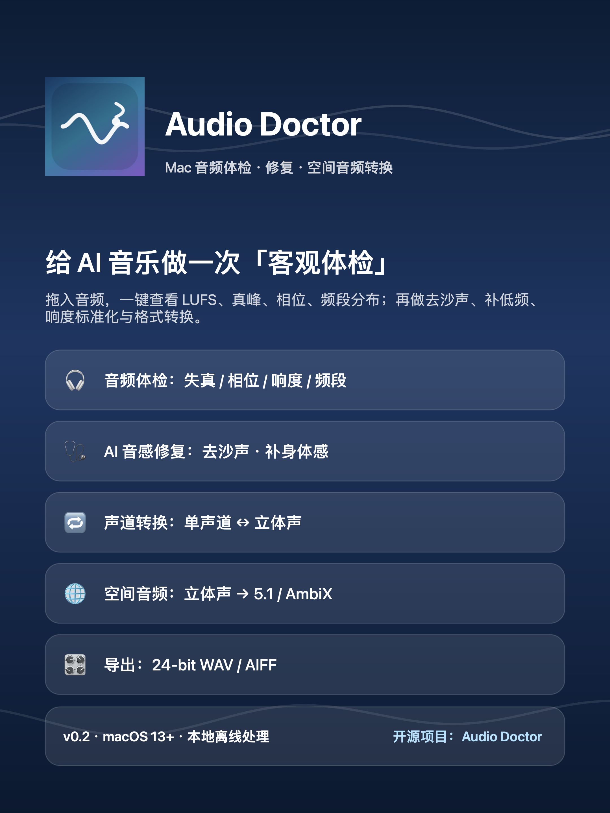

# Audio Doctor


[](https://github.com/Fanqz1010/AudioDoctor/releases)
[](LICENSE)



**Audio Doctor** 是一个原生 macOS SwiftUI / AVFoundation 桌面应用，用来给音乐、播客和 AI 生成音频做客观体检、轻量修复、声道转换和空间音频导出。它特别适合快速检查 Suno 等 AI 生成音乐中常见的高频沙沙声、频段偏薄、响度不一致和相位风险。

> 当前版本：**v0.4.0**
> 系统要求：**macOS 13+**  
> 处理方式：本地离线处理，不上传音频

## 核心功能

### 1. 音频体检

拖入 WAV / AIFF / M4A / MP3，查看：

- 综合响度 LUFS
- 真峰 True Peak
- 样本峰值 / RMS / 峰值因子
- 直流偏移
- 削波与失真风险
- 相位相关性与立体声宽度
- 频段能量分布
- 高频噪声占比
- 启发式「疑似 AI 感」评分
- AI 伪影七维拆解：沙声、金属闪烁、频谱空洞、偏薄、相位不稳定、瞬态模糊、立体声异常
- 时间轴 Badcase 定位：给出可疑区间、严重度、证据与处理建议

### 2. AI 伪影精修

默认处理链：

1. 高频稳态伪影 / 沙沙声抑制
2. 低频与身体感补偿
3. 可选参考曲频响匹配
4. 低频单声道化，改善单声道兼容
5. 包络跟随的瞬态恢复
6. 谨慎的空气感与细节增强
7. 响度标准化
8. 真峰限制

修复强度可调，默认链路保持保守，避免破坏瞬态和原曲个性。若处理后的高频噪声仍然偏高，空气感增强会自动减弱，避免“先去噪又加噪”。

### 3. 声道与空间音频转换

- 立体声 → 单声道
- 单声道 → 立体声
- 立体声 → 5.1 环绕声：`L R C LFE Ls Rs`
- 立体声 → 一阶 AmbiX：`W Y Z X`，ACN/SN3D

AmbiX 是开源空间音频生态中常用的交换格式，不等同于 Dolby Atmos 母版。

### 4. 内容优化与风格预设

第三工作台面向音乐/内容改良，提供：

- Suno 人声、Suno 流行、电子/舞曲、影视/配乐、播客/口播、通用音乐预设
- 低频身体感、低频声像稳定、瞬态攻击、空气感、响度目标分别可开关
- 根据当前文件的技术诊断生成优化方案
- 原始文件不覆盖，导出独立新文件

### 5. 千级批量标注中心

Audio Doctor 提供独立批量工作台，适合一次处理几十、几百到上千个音频：

- 递归扫描文件夹
- 只分析并导出 CSV 标注报告，不修改原音频
- 批量修复并导出 WAV / AIFF
- 顺序队列处理，降低千级任务内存风险
- 实时显示成功 / 失败 / 跳过 / 当前文件
- 中途取消也会保留已完成 CSV 记录
- 默认跳过已存在输出，可用于续跑
- 客观等级 A / B / C / D
- 每条记录包含响度、真峰、削波、动态、相位、左右平衡、单声道折叠损失、空间展开、低频能量、高频噪声、疑似 AI 感和七维 AI 伪影分
- 生成 CSV 全量明细和 HTML 批量总结
- HTML 报告包含 A/B/C/D 分布、集中问题排序、最需优先复核文件、批次处理建议和全量明细
- 每条记录写入时间轴 Badcase 定位，标注员可直接跳到可疑秒数试听

### 6. 导出

- WAV / AIFF
- 16-bit / 24-bit
- 多声道输出保留声道布局
- 空间输出峰值控制在安全范围

## 安装与构建

### 直接使用

1. 下载本地打包的 `AudioDoctor.app.zip`
2. 解压后双击 `Audio Doctor`
3. 如 macOS 提示无法验证开发者，右键 App →「打开」→ 再点「打开」

### 从源码构建

本仓库使用 Swift Package 结构。若本机只安装了 Apple Command Line Tools，可以直接编译：

```bash
SDK=$(xcrun --show-sdk-path)
swiftc -sdk "$SDK" -O -o build/AudioDoctor Sources/AudioDoctor/*.swift
```

在完整 Xcode 环境中也可以使用：

```bash
swift build -c release
```

## 轻量 Python 分析脚本

如果只需要快速查看基础参数，可以使用仓库自带的 Python 脚本：

```bash
python3 scripts/audio_analyzer.py input.wav
python3 scripts/audio_analyzer.py /path/to/folder
python3 scripts/audio_analyzer.py --no-stats input.wav
```

WAV 解析不需要第三方依赖，支持 8/16/24/32-bit PCM、文件批量扫描、峰值、RMS 电平和平均绝对值。安装 `soundfile` 后可扩展解析 MP3、FLAC、OGG、OPUS、AIFF 等格式。详见 [scripts README](scripts/README.md)。

> 这个脚本只做基础参数和电平统计；LUFS、真峰、相位、频段分析、修复和空间音频转换请使用 Audio Doctor 主程序。

## 命令行测试

二进制同时提供轻量测试入口：

```bash
AudioDoctor analyze input.wav
AudioDoctor repair input.wav output.wav [reference.wav]
AudioDoctor convert input.wav output.wav mono
AudioDoctor convert input.wav output.wav stereo
AudioDoctor convert input.wav output.wav surround51
AudioDoctor convert input.wav output.wav ambix
AudioDoctor batch input-folder output-folder analyze
AudioDoctor batch input-folder output-folder repair [reference.wav]
```

## 设计边界

- 「疑似 AI 感」和「AI 伪影总分」是透明启发式指标，不是标准听感评分，不用于判断音频来源，也不能用于规避 AI 检测。
- 时间轴定位是“优先试听位置”建议，不等同于最终人工结论。
- 空间转换是保守矩阵处理，不会真正分离人声、鼓组或混响分轨。
- AmbiX 不等于 Dolby Atmos。正式 Atmos 母版需要专用授权工具链与对象/床 metadata。
- 批量第一版使用顺序队列保护内存；尚未提供多线程并发配置和断点数据库。
- 客观标注标准用于降低主观偏差，不能完全替代最终人工试听。
- 当前不是 DAW 插件。

## 文档

- [中文使用说明](docs/user-guide-zh.md)
- [客观标注标准](docs/annotation-standards-zh.md)
- [开源方案调研](docs/research-zh.md)

## Roadmap

- 频谱图与相位示波器
- A/B 对比播放
- 分轨修复与重混
- 批量任务暂停 / 恢复数据库
- 多线程并发与队列优先级
- 可选神经网络去噪 / 音频超分
- 采样率转换与抖动控制
- MP3 / AAC 导出
- 高阶 Ambisonics 与双耳渲染预设

## License

MIT License. See [LICENSE](LICENSE).
